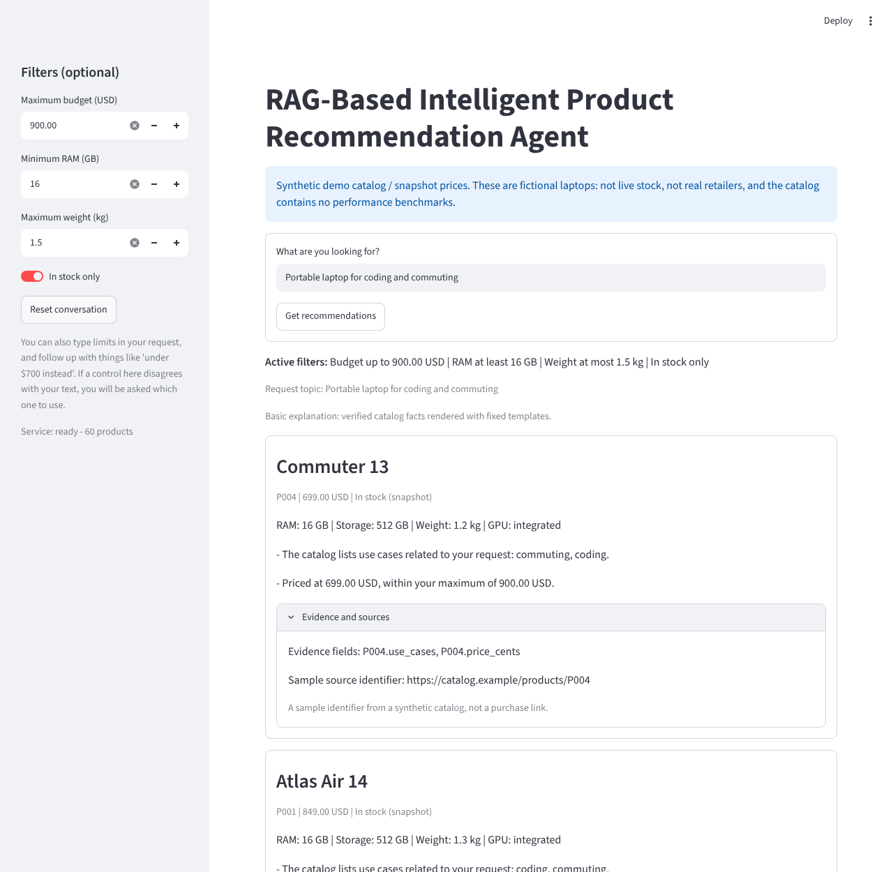

# RAG-Based Intelligent Product Recommendation Agent

[](https://github.com/a8li6/RAG-Based-Intelligent-Product-Recommendation-Agent/actions/workflows/ci.yml)


A Python application that reads a shopping request, **enforces explicit constraints in code**,
retrieves relevant products with a vector index (FAISS), and shows short, **evidence-backed
explanations** in which every displayed fact is checked against the catalog.



> **Honest scope.** The catalog is **synthetic** (60 fictional laptops). The default pipeline runs
> **fully offline with no neural model and no language model**: embeddings come from a built-in
> hashed TF-IDF embedder with a small curated concept lexicon, and explanations are deterministic
> templates. Optional E5 and local-LLM backends exist but are **not verified against real models**.
> Numbers below come from a small single-author evaluation set; read
> [docs/evaluation.md](docs/evaluation.md) before quoting any of them.

## Why this design

A catalog filter can enforce a price ceiling but cannot understand "a portable laptop for coding
and commuting". An unconstrained chatbot can discuss trade-offs but may invent products or specs.
This project combines the two:

- **Hard constraints (budget, RAM, weight, stock) are enforced by code**, never by a model.
  A product with an *unknown* value cannot satisfy a constraint on that value.
- **Filter first, then search**: the vector search covers every eligible product, so a global top-k
  cannot hide the only eligible match.
- **Grounded output**: the planner only chooses product IDs, evidence IDs and reason codes;
  sentences come from fixed templates filled with catalog values. A validator rejects any unknown
  ID, mismatched evidence, unsupported reason or false "unknown" claim.
- **Ambiguity becomes a question**: "something cheap" asks for a budget; "no match" explains which
  constraints excluded products and offers relaxation only as a question.

Example: the reference request with controls budget 900 USD, RAM >= 16 GB, weight <= 1.5 kg
(real output of `recommend` on the demo catalog; explanations are deterministic by default):

```text
Portable laptop for coding and commuting
  P004 Commuter 13      699.00 USD  - The catalog lists use cases related to your request: commuting, coding.
                                    - Priced at 699.00 USD, within your maximum of 900.00 USD.
  P001 Atlas Air 14     849.00 USD  - The catalog lists use cases related to your request: coding, commuting.
                                    - Priced at 849.00 USD, within your maximum of 900.00 USD.
  P046 Verdant Dev 14   849.00 USD  - The catalog lists use cases related to your request: coding, commuting.
                                    - Priced at 849.00 USD, within your maximum of 900.00 USD.
```

## Quick start (offline, nothing to download)

Requires Python 3.11. Dependencies come from PyPI only.

```bash
git clone https://github.com/a8li6/RAG-Based-Intelligent-Product-Recommendation-Agent.git
cd RAG-Based-Intelligent-Product-Recommendation-Agent
python3.11 -m venv .venv && source .venv/bin/activate        # Windows: .venv\Scripts\activate
python -m pip install -r requirements-lock.txt
python -m pip install --no-deps -e .

python -m recommender.cli validate-data --input data/demo/products.jsonl
python -m recommender.cli build-index  --input data/demo/products.jsonl
python -m recommender.cli recommend --query "Portable laptop for coding and commuting" \
    --max-price-cents 90000 --min-ram-gb 16 --max-weight-kg 1.5
```

Run the API and the interface (two terminals, same virtual environment):

```bash
python -m uvicorn recommender.api:app --host 127.0.0.1 --port 8000   # builds the index on first start
python -m streamlit run ui/app.py
```

No `.env` is required. Copy `.env.example` to `.env` only to change settings.

## How it works

```text
offline: validate catalog -> build documents -> fit + embed -> persist verified artifacts
online : interpret -> filter -> retrieve -> evidence -> explain -> validate -> render -> respond
```

See [docs/architecture.md](docs/architecture.md) for the diagram, the module map, ownership rules,
the artifact integrity checks and the failure paths.

| Piece | Choice |
|---|---|
| Retrieval | FAISS `IndexFlatIP` (exact) over normalized vectors, on the eligible subset only |
| Embedder | built-in hashed TF-IDF + curated concept lexicon (offline); optional E5 backend |
| Explanations | deterministic templates; optional local-LLM planner that can only pick evidence and codes |
| API / UI | FastAPI (stateless; follow-ups use a client-held session) / Streamlit |
| Quality | pytest, Ruff, GitHub Actions running the same script as local runs |

## Evaluation (held-out test split, shipped default configuration)

60 hand-written queries (20 development, 40 held-out test) over the 60-product synthetic catalog;
relevance is rule-based and independent of the retriever. Retrieval metrics use the
30 test queries that have a relevant eligible product.

| Retrieval method | Recall@10 | MRR@3 | nDCG@3 |
|---|---|---|---|
| This application (filter first, built-in embedder) | 0.721 | 0.983 | 0.921 |
| Keyword baseline (BM25) | 0.647 | 0.950 | 0.854 |
| Ablation: global top-10, filtered afterwards | 0.621 | 0.983 | 0.921 |
| Random order | 0.353 | 0.454 | 0.279 |

Recall@10 has a ceiling of 0.839 here because many products are relevant per query.

| End-to-end | Result |
|---|---|
| Hard-constraint violations among returned products | 0/96 |
| Displayed claims that match the catalog (independent audit) | 1344/1344 |
| Constraint interpretation accuracy | 33/33 |
| Status accuracy (ok / no_match / needs_clarification) | 38/40 |
| Abstention on irrelevant queries | 0/2 (**does not work**: see limitations) |
| Warm latency, in-process, 60 products | p50 0.79 ms, p95 1.30 ms |

The built-in embedder and BM25 are **comparable** on this set (the ordering changes between the
development and test splits), and there are no confidence intervals. Full tables, the protocol
(the abstention cutoff was calibrated on the development split only), per-category results and
failure cases are in [docs/evaluation.md](docs/evaluation.md); raw per-query outputs are in `reports/`.

## Data and licensing

- `data/sample/products.jsonl`: 8 fictional products used as the test reference.
- `data/demo/products.jsonl`: 60 fictional products (the demo catalog; the first 8 are the sample).
  Prices and stock are **snapshot values**, source URLs use the reserved `.example` domain, and no
  description makes a benchmark claim. See [docs/data_card.md](docs/data_card.md).
- Code is MIT licensed ([LICENSE](LICENSE)). Data and model licensing notes: [DATA_LICENSE.md](DATA_LICENSE.md).

## Configuration

All settings are optional; see `.env.example`. The important ones:

| Variable | Default | Meaning |
|---|---|---|
| `CATALOG_PATH` | `data/demo/products.jsonl` | catalog used to build the index |
| `ARTIFACT_DIR` | `artifacts/demo-v1` | where the verified index is stored (git-ignored) |
| `EMBEDDING_BACKEND` | `builtin` | `builtin` (offline) or `e5` (optional, needs a download) |
| `EXPLANATION_MODE` | `deterministic` | `llm` tries the optional local LLM, with deterministic fallback |
| `MIN_SIMILARITY` | unset | abstention cutoff; off by default (see limitations) |
| `RETRIEVAL_K`, `MAX_RECOMMENDATIONS` | `10`, `3` | candidates searched, products shown |
| `MAX_QUERY_CHARS`, `MAX_REQUEST_BYTES`, `MAX_CONCURRENT_REQUESTS` | `2000`, `16384`, `4` | input and load bounds |

## Tests and quality gates

```bash
bash scripts/check.sh      # exactly what CI runs: pip check, Ruff, validation, tests, evaluation smoke test
python -m recommender.cli evaluate --split test --runs 20      # reproduce the evaluation
```

The test suite needs no network, model download or running service. It covers schemas and
validation, eligibility boundaries, artifact integrity (shuffled mappings, tampering), retrieval of
the only eligible product below the global top-k, query parsing and follow-ups, grounding failures
(invented IDs, mismatched evidence, injection text), the API (valid, invalid currency, oversized,
empty result, artifact failure, generation fallback), the UI under Streamlit's test runner, and
architecture rules.

## Optional extras (not required, not verified here)

- `pip install -e ".[neural]"` and `EMBEDDING_BACKEND=e5` use `intfloat/multilingual-e5-small`
  (one-time download). Tested only with fakes: it was never run against the real model here.
- `EXPLANATION_MODE=llm` uses a local Ollama server (`qwen3:4b`). Tested only against mocked HTTP
  responses. The model can only select evidence and reason codes, and any failure falls back to the
  deterministic plan for the same products.

## Known limitations

- **Not a neural system by default.** The built-in embedder is lexical plus a curated vocabulary.
  It does not understand negation, and a lexical false friend is possible: "3D **modeling**" can
  match a travel notebook whose description says "14-inch **model**".
- **Abstention is unreliable.** An irrelevant query scored above an answerable one on the held-out
  split, so `MIN_SIMILARITY` is off; the calibration tool exists but did not generalize.
- **Small, synthetic, single-author data.** The catalog, queries, relevance rules and the concept
  lexicon share one author and vocabulary; results are optimistic and not evidence of real-world accuracy.
- One category (laptops), one currency (USD), English only. No live prices, stock or purchasing.
- The demo binds to a local interface; a public deployment needs its own authentication, rate
  limiting and TLS design.

## Project layout

```text
src/recommender/   config, schemas, catalog, documents, embeddings, local_embedder, index, retrieval,
                   query, ranking, llm, grounding, service, api, client, cli, metrics, evaluation
ui/app.py          Streamlit interface (talks to the API only)
data/              sample/ (8 products), demo/ (60 products), eval/ (60 labeled queries)
reports/           raw evaluation outputs
scripts/           catalog and evaluation-set generators, document renderer, check.sh
tests/             unit/, integration/, fixtures/
docs/              architecture, evaluation, data card, environment, product brief, progress log
```

## Roadmap

Run the optional E5 backend and LLM explainer against the real models and evaluate them on a fresh
held-out set; add field-aware weighting to the built-in embedder (needs that fresh set); a real,
licensed catalog; a native Persian evaluation track; more product categories with typed specs.
Each needs a working baseline, a measurable evaluation and a rollback path first.

## Contributing

Run `bash scripts/check.sh` before opening a pull request. Do not commit secrets, model weights,
virtual environments or generated artifacts.
