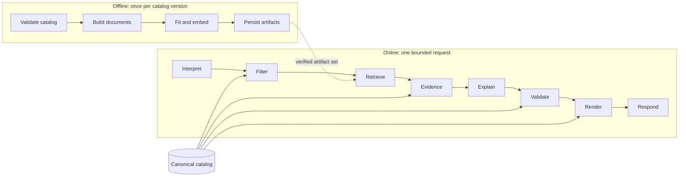

# Architecture

A bounded recommendation workflow: **understand, validate, retrieve, explain, verify, respond**.
Hard constraints are enforced by code; semantic retrieval ranks only the products that pass; every
sentence shown to the user is built from catalog data and fixed templates.

> **Languages.** English is the primary language. Persian *queries* are supported as an unreviewed
> prototype (see `docs/evaluation_fa.md`); responses are English and the catalog is not translated.
>
> **Honest scope.** The default pipeline is fully offline and contains **no neural model and no
> language model**. Embeddings come from a built-in hashed TF-IDF embedder with a small curated
> concept lexicon, and explanations are deterministic templates. An optional E5 embedding backend
> and an optional local-LLM explainer exist behind the same interfaces, but they have only been
> tested against mocks in this repository's environment (no model download or LLM server was
> available), so they are **not verified against real models**.

## Two pipelines, one source of truth

**Offline** (`build-index`): validate the JSONL catalog (rejecting the whole build on any error),
turn each product into one deterministic search document (price and stock are deliberately left
out), fit the embedder on those documents, embed them, and write the artifact set atomically.

**Online** (`recommend`): normalize and parse the request together with any structured controls,
compute the exact set of eligible products, search *only that subset*, pick up to three,
package immutable evidence records, produce an explanation plan, validate every reference against
the catalog, and render the response from canonical values.

## Who owns what

| Component | Owns | Never does |
|---|---|---|
| Catalog store | authoritative titles, prices, specifications, stock, source identifiers | trust model output |
| Parser (`query`) | explicit constraints and the semantic text | invent a constraint from vague words |
| Eligibility (`catalog`) | which products satisfy the hard constraints | rank |
| Retriever | candidate IDs and similarity scores over the eligible subset | filter or explain |
| Planner (deterministic, or the optional LLM) | which evidence supports which reason code | write sentences or facts |
| Validator (`grounding`) | what is permissible to show | accept an unknown ID, evidence or code |
| Renderer | user-visible facts and sentences, from the catalog and fixed templates | use model prose |

## Modules

| Module | Responsibility |
|---|---|
| `config.py` | validated settings; `IsolatedSettings` ignores `.env` and the environment (used by evaluation) |
| `schemas.py` | product, request, response, session, evidence and plan contracts |
| `catalog.py` | loading with line-numbered errors, unique IDs, canonical snapshot and SHA-256, eligibility predicates, validation report |
| `documents.py` | deterministic search text per product, token-length check |
| `embeddings.py` | vector contract and the optional E5 adapter (lazy import) |
| `local_embedder.py` | the built-in offline embedder and its persisted state |
| `persian.py` | Persian query normalization (digits, separators, letter variants), Persian constraint phrases and a concept lexicon mapped to the English concept ids (queries only; responses stay English) |
| `factory.py` | chooses the configured embedder |
| `index.py` | atomic artifact build, checksummed load, embedder-state restore |
| `retrieval.py` | exact search restricted to the eligible subset |
| `query.py` | intent parsing, structured-control merging, follow-up rules |
| `ranking.py` | candidate selection and evidence records |
| `llm.py` | versioned grounding prompt and the optional Ollama adapter (one attempt, no retry) |
| `grounding.py` | plan validation, deterministic plan, safe rendering |
| `service.py` | `recommend()`: the single orchestration function |
| `api.py` | FastAPI application around `recommend()` |
| `client.py` | the HTTP client and input checks the UI uses |
| `cli.py` | command-line entry points around the same service |
| `metrics.py` | evaluation formulas |
| `evaluation.py` | reproducible evaluation, baselines and calibration |

`ui/app.py` is the Streamlit interface. Boundary rules are enforced by
`tests/unit/test_architecture.py`: core modules never import a web framework, only `api.py` imports
FastAPI, the UI imports nothing from the core except the HTTP client and the response contracts,
and the API and CLI call the same `recommend()`.

## Artifact set and integrity

Each index version is a directory written to a temporary location, fully verified, then activated
as one unit:

| File | Content |
|---|---|
| `products.faiss` | exact inner-product index over the normalized vectors |
| `embeddings.npy` | the vectors (used for subset searches) |
| `product_ids.json` | row position to stable product ID |
| `catalog.jsonl` | the canonical, ID-sorted catalog snapshot |
| `embedder.json`, `embedder.npy` | fitted state of the built-in embedder |
| `manifest.json` | schema version, catalog SHA-256, per-file SHA-256, row count, dimension, embedder and revision, prefixes, normalization, document-format version, token statistics, build timing, dependency versions |

Loading refuses a missing file, a checksum mismatch, a shuffled ID mapping (even if its checksum
was rewritten), an index that disagrees with the stored vectors, invalid embedder state, or an
embedder that differs from the one that built the index. Only JSON and NumPy arrays with
`allow_pickle=False` are read. The API builds a missing directory once at startup but never
rebuilds a corrupt one.

## Request lifecycle and failure paths

| Situation | Behavior |
|---|---|
| Empty, blank or oversized query | rejected (`422`), values never echoed |
| Ambiguous, contradictory or unsupported constraint | `needs_clarification` with a question; session unchanged |
| No product satisfies the constraints | `no_match`; says which explicit constraints excluded products and offers a relaxation only as a question; the budget is never changed silently |
| Weak retrieval and `MIN_SIMILARITY` set | `needs_clarification` (off by default; see Limitations) |
| Optional LLM unavailable, timed out, or its plan fails validation | deterministic plan for the **same** products; `explanation_mode` and `fallback_reason` say so |
| Artifacts missing or corrupt | readiness failure and a controlled `503` with a rebuild instruction, no paths |

## API

| Endpoint | Purpose |
|---|---|
| `GET /health` | liveness; loads nothing |
| `GET /ready` | artifact version, catalog size, embedder, mode; `degraded` if an optional LLM is configured but down |
| `POST /recommendations` | one validated request; stateless (follow-ups use the client-held `session`) |

Errors use `{error_code, message, details?}`. A bounded gate returns `429` when the service is busy;
unexpected errors become a generic `500` with only a request ID.

## Decisions and trade-offs

- **Filter first, then search.** Filtering a global top-10 afterwards can lose every eligible
  product; the evaluation measures Recall@10 of 0.721 against 0.621 on the held-out split.
- **Price and stock stay out of the embedding.** They are volatile and enforced by exact code, so a
  price change never forces re-embedding.
- **Exact search.** For tens to thousands of products, an exact flat index is simpler and has no
  approximation error to measure.
- **A built-in embedder by default.** It removes every network and download dependency, at the cost
  of semantic depth (see Limitations). The retrieval interface is unchanged if a neural embedder is
  used instead.
- **Stateless server, client-held session.** Follow-ups such as "under $700 instead" work without a
  user database; the session is validated like any other input.
- **Deterministic explanations by default.** The LLM can only select evidence and reason codes;
  sentences always come from templates, so schema-valid-but-wrong prose cannot reach the user.
- **Plain functions, no orchestration framework.** Nothing in the flow needed one.

## Security boundaries

User text, catalog text and model output are all treated as untrusted. Enforced and tested:
no pickle or dynamic execution, no environment reads outside settings, bounded query/body/concurrency,
JSON-escaped prompt sections, validation errors that never echo input, no stack traces or paths in
responses, and no raw user text in logs. The demo binds to a local interface; a public deployment
needs its own authentication, rate limiting and TLS design.

## Limitations

- The built-in embedder is lexical plus a curated vocabulary: it cannot understand negation, and
  only concepts in its lexicon generalize. A false friend is visible in practice: for "laptop for 3D
  modeling and rendering" a travel notebook can outrank a 3D-tagged product because its description
  contains the word "model". Improving this requires a fresh held-out set, because the current test
  split has already been used.
- Raw similarity is not calibrated: an irrelevant query scored above an answerable one on the
  held-out split, so the abstention cutoff is off by default.
- The catalog and the evaluation set are synthetic and single-author; see `docs/evaluation.md`.
- Persian query support is a prototype: the queries and the lexicon were written by one AI author and not
  reviewed by a native speaker, and a request with no lexicon word retrieves nothing meaningful.
- The optional E5 and LLM paths are unverified against real models.
